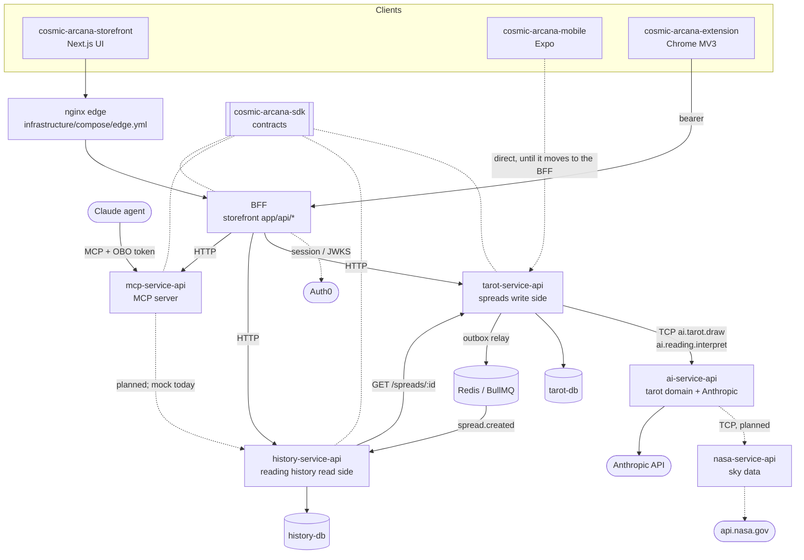

# Architecture

Cosmic Arcana is an AI fortune-teller. A user asks about their future, a decision, a relationship or a
career; the system draws tarot cards, may add real sky data and the user's previous readings, and an
AI writes a prediction. **The prediction is fiction. NASA data is real and used only as symbolism.**

Every service is its own repository in the `Cosmic-Arcana` organization. This page is the picture
none of them shows alone.

## System



Solid lines are wired today; dashed lines are planned or partial. Live status per piece:
[status.md](status.md).

## Repositories

| Repository | Stack | Owns | Ports |
| --- | --- | --- | --- |
| `cosmic-arcana-storefront` | Next.js 16, React 19, Tailwind 4, Auth0 | UI and the BFF, the only frontend-facing API; origin of `correlationId` | 3000 |
| `ai-service-api` | NestJS 11, Anthropic SDK | Tarot domain (78-card deck, spreads, draw), interpretation, every LLM call. Stateless | 3001, TCP 4001 |
| `nasa-service-api` | NestJS 11 | NASA retrieval, normalization, caching | 3002, TCP 4002 |
| `mcp-service-api` | NestJS 11, MCP SDK v2 | The agent's only doorway (`/mcp`): tools, agent identity, activity feed | 3003 |
| `tarot-service-api` | NestJS 11, TypeORM, BullMQ | Spread aggregate (write side); sole producer of `spread.created` | 3004, db 5433 |
| `history-service-api` | NestJS 11, TypeORM, BullMQ | Reading-history read model; consumes `spread.created` | 3005, db 5434 |
| `cosmic-arcana-sdk` | TypeScript, zero runtime deps | `@cosmic-arcana/sdk`: event, resource and MCP contracts with parsers; zod mirrors under `/mcp` | — |
| `cosmic-arcana-mobile` | Expo 57, React Native | iOS / Android / web client | — |
| `cosmic-arcana-extension` | Chrome MV3 | Popup client; Auth0 PKCE, asks through the BFF | — |
| `cosmic-arcana-infrastructure` | GitHub Actions, Node, compose, nginx | Reusable CI, release manifests, application validation, edge, load tests, wikis, dependency graph | — |
| `arcana-rng-lab`, `arcana-prng-fingerprint` | Python | Research labs on randomness. **Production never imports them** | — |
| `demo-repository` | — | Sample only; not a reference | — |

## Flows

### Ask for a reading (write side)

```text
client ──▶ BFF POST /api/spreads ──▶ tarot POST /spreads   (idempotency-key)
                                       │ TCP ai.tarot.draw        ─▶ ai-service: deterministic draw
                                       │ TCP ai.reading.interpret ─▶ ai-service: Anthropic interpretation
                                       ▼
                         one transaction: spread + spread_card + outbox row
                                       ▼
                         outbox relay (addBulk) ──▶ BullMQ queue `spread.created`
```

- A replayed `idempotency-key` with the same body returns the stored spread with
  `idempotency-replayed: true`; the same key with a different body is `409`.
- ai-service outage surfaces as `503`; the interpretation call has its own 60 s timeout and no SDK retry.

### Build the history (read side)

```text
BullMQ `spread.created` ──▶ history-service processor
                              │ GET /spreads/:id on tarot (the event carries ids only)
                              ▼
                 one transaction: inbox row + spread_history upsert
                              ▼
BFF /api/readings ──▶ GET /users/:id/spread-history (cursor pages), GET one reading
```

At-least-once delivery: the outbox guarantees publish, the inbox guarantees apply-once.

### Agent path

```text
Claude agent ──MCP──▶ mcp-service-api ──(planned) OBO token exchange──▶ PostgreSQL MCP
                       token: sub=<user>, act=ai_agent                    `cosmic_agent` schema + RLS
```

- Tool today: `get_previous_readings` (limit 1–10, default 3) returning `ReadingSummaryV1`, summary
  only, never the full prediction. Backed by a mock adapter until the history path exists.
- Every tool call is recorded per user and shown live in the storefront at `/agent` (BFF proxies
  `GET /agent-activity` and its SSE stream).
- The token is decoded, not verified, until the authority service exists. Identity is observability,
  never authorization.

### Identity

- Auth0 for every client. The BFF accepts the session cookie (web) or a verified bearer token
  (JWKS, API audience) from the extension and, later, mobile.
- GitHub and Google social logins; accounts link only when both emails are verified.
- Sign-out is per client (no revoke-everywhere on this Auth0 plan).
- `REQUIRE_SPREAD_AUTH` stays off until mobile goes through the BFF.
- Planned `authority-service-api`: one identity form for MCP and readings.

### Delivery

```text
service repo push ──▶ reusable service-ci.yml (infra) ──▶ image on GHCR (by digest)
                                     │ repository_dispatch service-updated
                                     ▼
          candidate manifest (changed service = new digest, others unchanged)
                                     ▼
   application validation: health, contract, integration, browser e2e (dev + production build)
                                     ▼
                 promote ──▶ known-good manifest ──▶ release ──▶ deploy (stub)
```

The application version is a manifest of image digests, never `latest`.

## Local run

```bash
docker compose up -d                 # tarot-db 5433, history-db 5434, redis 6379 (workspace root)
cd cosmic-arcana-sdk && npm ci && npm run build
cd ../tarot-service-api && npm ci && cp .env.example .env && npm run start:dev
cd ../history-service-api && npm ci && cp .env.example .env && npm run start:dev
```

Services consume the SDK as `github:Cosmic-Arcana/cosmic-arcana-sdk#semver:^0.1.0` (currently
`0.1.1`); migrations run on start.
