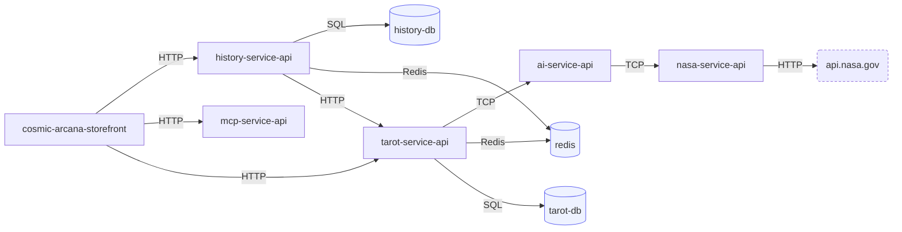

# Cosmic Arcana

An AI fortune-teller, and an experiment in how far an engineer can delegate to Claude Code without
losing engineering control.

You ask a question. An agent draws tarot cards, reaches for real NASA data, reads your previous
readings and writes a prediction. The prediction is fiction. The astronomy is not.

## The system

A Next.js frontend and BFF in front of NestJS microservices. Writes and reads are separated: the
service that owns a fact announces it through a transactional outbox, and every read model is built
by the service that owns it. A database per service, one Redis as the broker, and an MCP server as
the agent's only doorway into the application.

## The system at a glance

An arrow means a service is configured with the address of another. Redis carries the BullMQ queues,
so two services pointing at it are the producer and the consumer of the same events.

| Repository | What it is |
| --- | --- |
| [cosmic-arcana-storefront](https://github.com/Cosmic-Arcana/cosmic-arcana-storefront) | Frontend and BFF (Next.js) |
| [ai-service-api](https://github.com/Cosmic-Arcana/ai-service-api) | Tarot readings and predictions through the Anthropic SDK |
| [nasa-service-api](https://github.com/Cosmic-Arcana/nasa-service-api) | Real sky data: fetched, normalized, cached |
| [mcp-service-api](https://github.com/Cosmic-Arcana/mcp-service-api) | MCP tools for the agent, with on-behalf-of tokens and user-scoped access |
| tarot-service-api | Spreads write side, the only producer of `spread.created` |
| history-service-api | Spread-history read side, an idempotent projection |
| cosmic-arcana-sdk | The contracts the services agree on |

## How it is built

Planned, implemented, tested and reviewed with Claude Code, much of it through Remote Control from a
phone. Skills, hooks, subagents, MCP, BDD and context budgeting are the point of the exercise, not
decoration.

Readings are entertainment. Nothing here claims the future is knowable.
